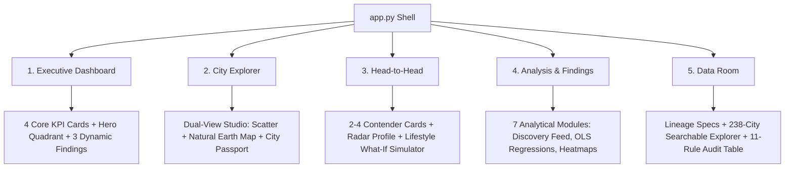

# URBAN INTELLIGENCE: The Global Liveability Observatory

[](https://share.streamlit.io/deploy?repository=Ashith64/urban-intelligence&branch=main&mainModule=app.py)
[](https://github.com/Ashith64/urban-intelligence)
[](https://www.python.org/)
[](LICENSE)
[](tests/)

> **"Where can people enjoy a better balance of affordability, purchasing power, quality of life, and environmental conditions?"**

A high-performance exploratory urban data intelligence platform analyzing **238 global cities** across **83 countries and territories**, synthesizing multi-source city observations (purchasing power, cost of living, property price-to-income, safety, healthcare, climate, pollution, and traffic commute times) with official **World Bank 2023 macroeconomic indicators** (GDP per capita, life expectancy, urban population share).

---

## 🌐 Live Application Deployment

Deploy or run this application instantly on **Streamlit Community Cloud**:

👉 **[Deploy 1-Click to Streamlit Cloud](https://share.streamlit.io/deploy?repository=Ashith64/urban-intelligence&branch=main&mainModule=app.py)**

Or visit your personal Streamlit Community Cloud workspace at [share.streamlit.io](https://share.streamlit.io/) and point to:
- **Repository**: `Ashith64/urban-intelligence`
- **Branch**: `main`
- **Main file path**: `app.py`

---

## 🎨 Design System: Obsidian Luxe

The platform features a custom-engineered **Obsidian Luxe** visual hierarchy inspired by institutional terminals and Bloomberg/Power BI interfaces:

| Token | Hex | Role |
| :--- | :--- | :--- |
| **Main Background** | `#0B0E12` | Deep canvas obsidian |
| **Sidebar Canvas** | `#10151B` | Structural dark navigation surface |
| **Primary Surfaces** | `#141A21` | Metric cards and analytical panels |
| **Elevated Surfaces** | `#1B232C` | Modals, active states, and hovered cards |
| **Borders** | `#28323D` | Crisp, low-contrast component dividers |
| **Primary Text** | `#F0F1ED` | High-contrast editorial typography (Inter) |
| **Secondary Text** | `#929DA8` | Analytical captions and metadata |
| **Emerald Accent** | `#55B89A` | Favourable environmental & quality outcomes |
| **Champagne Gold** | `#C6A46A` | Benchmarks, global medians, and highlights |
| **Muted Coral** | `#D97870` | Adverse conditions (pollution, high cost) |

---

## 🧭 Five Destination Architecture



### 1. 🏛️ Executive Dashboard (`1_Executive_Dashboard.py`)
- **10-Second Executive Overview**: Instant global situational awareness.
- **Dynamic KPI Row**: Cities Analysed (238), Countries Represented (83), Median Purchasing Power (51.2), Median Quality of Life (140.2).
- **Hero Liveability Quadrant**: Interactive scatter plot of Quality of Life vs. Cost of Living Index with quadrant crosshairs at median coordinates (140.2, 45.4).
- **Automated Insights Row**: Dynamic callout cards highlighting the Highest Balance City, Value Champion, and Environmental Pioneer.
- **Regional Landscape Chart**: Mean performance by geographic continent.

### 2. 🔍 City Explorer (`2_City_Explorer.py`)
- **Dual-View Exploration**: Switch seamlessly between **Scatter Relationship Studio** and **Natural Earth Geospatial Map**.
- **Multi-Criteria Contextual Filters**: Real-time filtering by Region, Cost Index range, Quality of Life range, and PM2.5 threshold.
- **Dynamic OLS Trendlines**: Real-time slope, intercept, and $R^2$ calculation without external dependencies.
- **City Passport Drawer**: Deep-dive profile for any selected city including all 11 core dimensions and radar balance preview.

### 3. ⚔️ Head-to-Head (`3_Head_to_Head.py`)
- **Contender Comparison**: Compare 2 to 4 global cities side-by-side.
- **Key Metrics Matrix**: Visual grouped bar charts across economic, environmental, and infrastructure pillars.
- **6-Axis Spider / Radar Profile**: Visualizing holistic trade-offs across Purchasing Power, Quality of Life, Safety, Health Care, Low Cost, and Clean Air.
- **Benchmark Variance Matrix**: Calculates exact percentage deltas against the global median.
- **Interactive What-If Simulator**: Weight preferences across 3 lifestyle presets (*Balanced Living*, *Cost-First Expat*, *Green & Healthy*) or custom weights.

### 4. 📈 Analysis & Findings (`4_Analysis_Findings.py`)
- **Automated Discovery Feed**: 8 algorithmic discoveries dynamically generated from the live dataset.
- **Statistical Overview**: Summary statistics (Mean, Median, Std, IQR, Min, Max) for all 12 indicators.
- **Relationship Explorer**: Interactive bivariate scatter plots with dynamic OLS regression parameters.
- **Correlation Studio**: Filterable correlation matrix and pairwise ranking.
- **Distribution Lab**: Interactive histograms with adjustable bin counts.
- **Regional Intelligence**: Distribution box plots comparing regional variance.
- **Custom Visualization Studio**: Build custom charts and download raw CSV data or standalone interactive HTML figures.

### 5. 🗄️ Data Room (`5_Data_Room.py`)
- **Provenance & Lineage Specifications**: Transparent documentation of all source datasets, collection timeframes, and observation counts.
- **Interactive Data Explorer**: Searchable, filterable 238-city master table with direct CSV export.
- **Automated Data Quality Audit**: 11-point validation check covering range compliance, schema types, and outlier detection.
- **Outlier Treatment Policy**: Transparent documentation of Tukey's $1.5 \times \text{IQR}$ fences.
- **Normalization Mathematical Formulas**: Rendered KaTeX equations for min-max normalization and directional inversion.

---

## 📊 Dataset Provenance & Harmonization

| Indicator | Source | Scope | Refresh Cadence |
| :--- | :--- | :--- | :--- |
| **Quality of Life, Purchasing Power, Cost of Living** | Numbeo Global Living Index | 238 Cities | Annual Snapshot |
| **PM2.5 Air Quality & Environmental Quality** | IQAir World Air Quality Report | 238 Cities | Annual Mean ($\mu\text{g/m}^3$) |
| **Traffic Commute & Travel Time** | TomTom Traffic Index / Numbeo | 238 Cities | One-Way Commute (min) |
| **GDP per Capita, Life Expectancy, Urban Share** | World Bank Open Data API (2023) | 83 Countries | Official Annual Macro Data |

---

## 🛠️ Quickstart & Local Execution

### 1. Prerequisites
- Python 3.10+ (tested on Python 3.10, 3.11, 3.12, 3.14)
- Git

### 2. Clone and Setup Environment
```bash
git clone https://github.com/Ashith64/urban-intelligence.git
cd urban-intelligence

# Create virtual environment
python -m venv .venv

# Activate virtual environment
# Windows PowerShell:
.\.venv\Scripts\Activate.ps1
# Linux / macOS:
source .venv/bin/activate

# Install runtime dependencies
pip install -r requirements.txt
```

### 3. Launch Streamlit Application
```bash
streamlit run app.py
```
Open your browser to `http://localhost:8501`.

---

## 🧪 Automated Testing

Verify the analytical calculations, normalization pipelines, and page rendering:

```bash
pytest tests/ -v
```

```
tests/test_analysis.py ......                                            [ 33%]
tests/test_app.py ......                                                 [ 66%]
tests/test_pipeline.py ......                                            [100%]

============================= 18 passed in 7.21s ==============================
```

---

## 📄 License
This project is open-source under the MIT License. See [LICENSE](LICENSE) for details.
